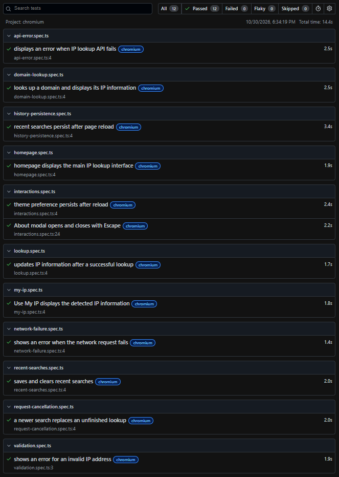

# IPTracker


A responsive IP address and domain lookup application built with React and TypeScript. Explore approximate geolocation, network information, and interactive maps through a clean, accessible interface.

**[Live Demo](https://ip-address-trac-lovat.vercel.app/)**

## Features

- **IP & Domain Lookup** — Search IPv4, IPv6 addresses, and domains.
- **Use My IP** — Detect and look up the visitor's public IP address.
- **Interactive Map** — Visualise approximate locations using React Leaflet and OpenStreetMap.
- **Location & Network Details** — View the IP address, city, region, country, timezone, ISP, and available ASN information.
- **Recent Searches** — Store up to five searches locally, revisit previous results, and clear search history. History persists after a page reload.
- **Light & Dark Mode** — Switch themes with preferences saved in localStorage.
- **Request Cancellation** — Cancel an unfinished lookup when a new search starts, preventing outdated results from replacing newer ones.
- **Error Handling** — Display feedback for invalid input, API failures, and network errors.
- **About Dialog** — Explain the application and the limitations of IP geolocation.
- **Responsive Design** — Support desktop, tablet, and mobile layouts.
- **Accessibility** — Use semantic HTML, accessible labels, keyboard navigation, and native dialog interactions.

## Tech Stack

| Category | Technologies |
| --- | --- |
| Frontend | React 19, TypeScript, Vite |
| Styling | CSS |
| Maps | React Leaflet, Leaflet, OpenStreetMap |
| IP Geolocation | GeoIPify API |
| Backend | Vercel Functions |
| Testing | Playwright, Chromium |
| Code Quality | Oxlint, TypeScript |
| Continuous Integration | GitHub Actions |
| Deployment | Vercel |
| Version Control | Git, GitHub |

## How It Works

1. The user enters an IP address or domain, or selects **Use My IP**.
2. The frontend sends a request to `/api/lookup`.
3. A Vercel Function handles the lookup and communicates with GeoIPify using a server-side API key.
4. The response updates the information cards, interactive map, and location details.
5. Successful lookups are saved to localStorage for quick access.
6. If another search begins before the previous one finishes, the frontend uses `AbortController` to cancel the outdated request.

### Architecture

```text
User
  |
  v
React + TypeScript
  |
  v
Vercel Function (/api/lookup)
  |
  v
GeoIPify API
  |
  v
IP Details + Interactive Leaflet Map
```

The GeoIPify API key is stored in server-side environment variables and is not included in the client-side bundle.

## Getting Started

### Prerequisites

- Node.js version compatible with Vite 8
- npm
- GeoIPify API key
- Vercel CLI for local API development

### Installation

Clone the repository:

```bash
git clone https://github.com/quhtrang-cloud/ip-address-tracker.git
cd ip-address-tracker
```

Install dependencies:

```bash
npm install
```

### Environment Variables

Create a `.env.local` file in the project root:

```env
GEOIPIFY_API_KEY=your_geoipify_api_key
```

Keep API keys private. Files containing local credentials are excluded from version control. For production, configure `GEOIPIFY_API_KEY` in the Vercel project settings.

### Run Locally

To run the frontend and Vercel Functions together:

```bash
npx vercel dev
```

Open the local URL shown in the terminal.

To run only the Vite frontend:

```bash
npm run dev
```

**Note:** Vite alone does not execute the Vercel Function at `/api/lookup`. Live searches need the backend. The **Use My IP** feature is best verified on the deployed website because local request headers may not identify the visitor's public IP.

## Testing

The project uses **Playwright** to test user-facing behaviour in Chromium. The current suite includes **12 automated end-to-end scenarios**.

| Test | What it verifies |
| --- | --- |
| Homepage UI | Main interface and search components render correctly |
| Input Validation | Invalid IP input produces an error message |
| IP Lookup | A mocked lookup response updates displayed information |
| Domain Lookup | Domain search displays information from a mocked API response |
| Use My IP | Public IP lookup displays the mocked result |
| Theme Persistence | The selected theme remains after a page reload |
| About Dialog | The dialog opens and closes using Escape |
| Recent Searches | Search history can be saved and cleared |
| History Persistence | Recent searches remain after a page reload |
| API Error Handling | HTTP API failures show an error and allow another attempt |
| Network Failure | A failed network request shows an error and leaves the interface usable |
| Request Cancellation | A newer search takes priority over an unfinished lookup |

**Latest local result:** 12 passed, 0 failed, on Chromium.

### Test Results



*Playwright HTML report showing the 12 passing test scenarios. The image is included in the repository under `docs/images/`.*

### Run Tests

Install the browser:

```bash
npx playwright install chromium
```

Run the full suite:

```bash
npx playwright test
```

Open Playwright UI mode:

```bash
npx playwright test --ui
```

View the HTML report:

```bash
npx playwright show-report
```

Repeat each test three times to help identify unstable tests:

```bash
npx playwright test --repeat-each=3
```

Playwright starts the configured Vite development server automatically. Tests involving API results use mocked responses so they are repeatable and do not consume GeoIPify quota. Mocked tests do **not** verify the live GeoIPify service or production backend end-to-end.

## Continuous Integration

GitHub Actions runs the CI workflow on pushes to `main` and pull requests targeting `main`.

The workflow:

1. Installs dependencies with `npm ci`.
2. Runs code quality checks with Oxlint.
3. Type-checks and builds the production application.
4. Installs Chromium and required system dependencies.
5. Runs the Playwright test suite.
6. Uploads the Playwright HTML report as a workflow artifact.

The configuration is in `.github/workflows/ci.yml`.

**[View CI Workflow](https://github.com/quhtrang-cloud/ip-address-tracker/actions)**

Vercel manages deployment separately. A successful CI setup does not, by itself, prevent Vercel from deploying a commit if tests fail.

## Available Commands

| Command | Description |
| --- | --- |
| `npm run dev` | Start the Vite development server |
| `npm run build` | Type-check and build for production |
| `npm run preview` | Preview the production frontend |
| `npm run lint` | Run Oxlint |
| `npx playwright test` | Run automated E2E tests |
| `npx playwright test --ui` | Open the interactive Playwright test runner |
| `npx playwright test --repeat-each=3` | Repeat each test three times |
| `npx playwright show-report` | Open the latest Playwright HTML report |
| `npm audit` | Check dependencies for known vulnerabilities |

## Project Structure

```text
ip-address-tracker/
├── .github/
│   └── workflows/
│       └── ci.yml
├── api/
│   └── lookup.ts
├── docs/
│   └── images/
│       └── playwright-report.png
├── public/
│   ├── favicon.svg
│   └── ip-network-map.svg
├── src/
│   ├── components/
│   │   ├── AboutModal.tsx
│   │   ├── Header.tsx
│   │   ├── IpSummary.tsx
│   │   ├── LocationDetails.tsx
│   │   ├── LocationMap.tsx
│   │   ├── RecentSearches.tsx
│   │   └── SearchBar.tsx
│   ├── services/
│   │   └── ipApi.ts
│   ├── types/
│   │   └── ip.ts
│   ├── utils/
│   │   └── validation.ts
│   ├── App.tsx
│   ├── App.css
│   ├── index.css
│   └── main.tsx
├── tests/
│   ├── api-error.spec.ts
│   ├── domain-lookup.spec.ts
│   ├── history-persistence.spec.ts
│   ├── homepage.spec.ts
│   ├── interactions.spec.ts
│   ├── lookup.spec.ts
│   ├── my-ip.spec.ts
│   ├── network-failure.spec.ts
│   ├── recent-searches.spec.ts
│   ├── request-cancellation.spec.ts
│   └── validation.spec.ts
├── .gitignore
├── index.html
├── package.json
├── package-lock.json
├── playwright.config.ts
├── tsconfig.api.json
├── tsconfig.app.json
├── tsconfig.json
├── tsconfig.node.json
├── vite.config.ts
└── README.md
```

Generated folders such as `dist/`, `playwright-report/`, and `test-results/` are excluded from version control.

## Privacy & Limitations

- IP geolocation estimates a network location; it does not provide precise GPS coordinates.
- Accuracy varies by IP address, network, and geolocation provider.
- VPNs and proxies may affect the detected IP and location.
- Recent searches are stored locally in the browser using localStorage.
- The GeoIPify API key is kept out of client-side source code.
- Lookups depend on the external API's availability and usage limits.
- Automated tests using mocked API responses do not guarantee production API availability or geolocation accuracy.

## Data Attribution

- [GeoIPify](https://geo.ipify.org/) — IP geolocation and network information
- [OpenStreetMap](https://www.openstreetmap.org/copyright) — Map data
- [Leaflet](https://leafletjs.com/) — Interactive mapping library

## Author

Developed by [Quynh Trang Nguyen](https://github.com/quhtrang-cloud).
